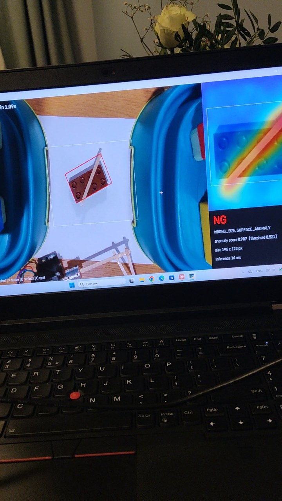

# Duplo Inspection Cell

Инспекционна клетка с машинно зрение и AI: 3D камера (Intel RealSense D435) намира детайл,
PatchCore (откриване на аномалии, обучен само на годни детайли) решава OK/NG, а стъпков двигател
с рамо удря негодните.

*A small machine-vision inspection cell: RealSense D435 → part localisation and alignment → size
rule + PatchCore anomaly detection → OK/NG → Arduino-driven stepper arm strikes rejected parts.
Write-up in Bulgarian; design spec and findings in English.*

**▶ [Видео на клетката в действие (YouTube)](https://youtube.com/shorts/m8cPQQS8TpA)**

[](https://youtube.com/shorts/m8cPQQS8TpA)

## Документация

- **[Демо и резултати (BG)](docs/demo_bg.md):** какво показва, как работи, резултати без
  разкрасяване, проблеми и решения.
- [Design spec (EN)](docs/superpowers/specs/2026-10-11-duplo-inspection-design.md): архитектура,
  Modbus RTU карта на регистрите, машина на състоянията, самодиагностика.
- [Spike findings (EN)](docs/findings/2026-10-11-anomaly-spike.md): първата проба и какво промени.

## Структура

| Папка | Съдържание |
|---|---|
| `cell/` | намиране и изправяне на детайла (`geometry.py`), правило за размер (`rules.py`), PatchCore инференция (`anomaly.py`), Modbus RTU master с handshake и watchdog (`actuator.py`), кога да се удари и проверка с камерата, че ударът е успял (`reject.py`) |
| `tools/capture.py` | заснемане на набор данни: заключване на експозиция/баланс на бялото, зона за инспекция (`-`/`+`, стрелки) |
| `tools/inspect_test.py` | инспекция на живо: `R` реално време, `A` автоматичен удар на NG, `SPACE` единична снимка, `K` ръчен удар, `X` нулиране на грешка |
| `tools/camera_check.py` | проверка на камерата: USB връзка, цвят + дълбочина |
| `train/train_model.py` | обучение, избор на праг върху валидационен набор, `models/meta.json` |
| `train/result_images.py` | изображенията с резултати в `docs/images` |
| `firmware/reject_cell/` | Arduino Mega като Modbus RTU slave: неблокиращ удар, heartbeat, watchdog, грешки (`RejectController` е без Arduino зависимости и се тества на PC) |
| `firmware/motor_test/` | първоначален тест на двигателя: текстови команди по USB serial |
| `tests/` | `pytest`: master срещу симулиран slave, slave логиката (C++, компилира се с g++/clang++), master срещу истинската slave логика, Modbus кадри на ниво байтове |
| `spike/` | първата (еднократна) проба, запазена за справка |

## Стартиране

```bash
python -m venv .venv
.venv\Scripts\pip install torch==2.11.0 torchvision==0.26.0 --index-url https://download.pytorch.org/whl/cu128
.venv\Scripts\pip install -r requirements.txt
```

```bash
.venv\Scripts\python tools\capture.py --session session1     # SPACE = годен, D = дефект
.venv\Scripts\python train\train_model.py --session session1
.venv\Scripts\python tools\inspect_test.py --port COM4
```

Снимките (`data/`) и обученият модел (`models/`) не са в хранилището заради размера. Моделът
се обучава наново за около 5 s.

Фърмуер: `arduino-cli compile --fqbn arduino:avr:mega firmware/reject_cell` и
`arduino-cli upload -p COM4 --fqbn arduino:avr:mega firmware/reject_cell`
(библиотеки: `arduino-cli lib install AccelStepper ModbusRTUSlave`). Свързване: PUL+ → D2,
DIR+ → D3, PUL− и DIR− → GND.

Тестове (без камера и Arduino; C++ частта се пропуска, ако няма g++/clang++):

```bash
.venv\Scripts\python -m pytest
```

## Хардуер

Intel RealSense D435 · лаптоп с NVIDIA RTX 3080 · Arduino Mega 2560 · TB6600-тип драйвер
(1/16 стъпка, 1.0 A) · NEMA 17 · рамо от дървени пръчици.
