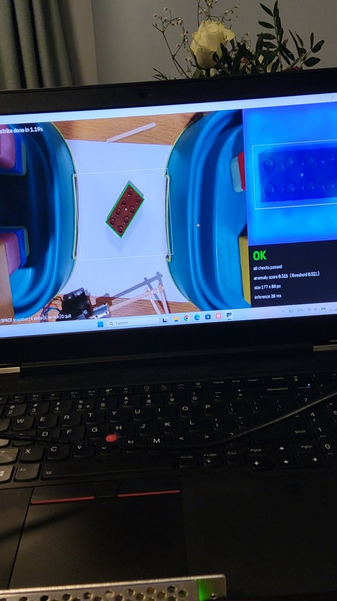
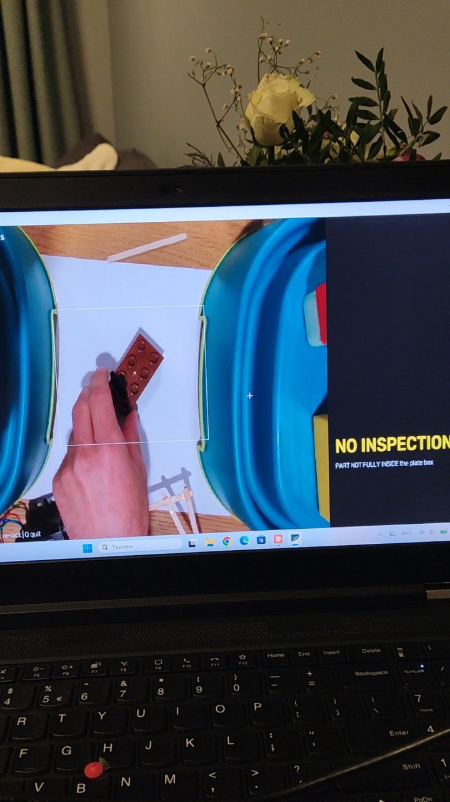
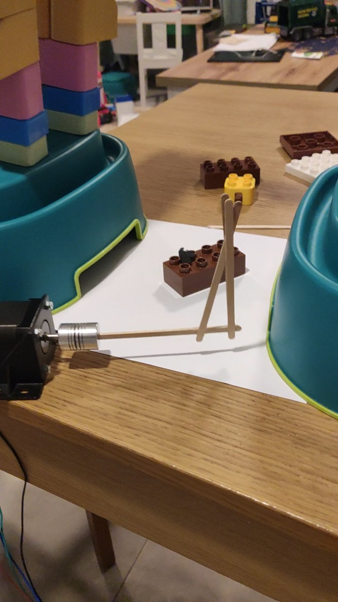
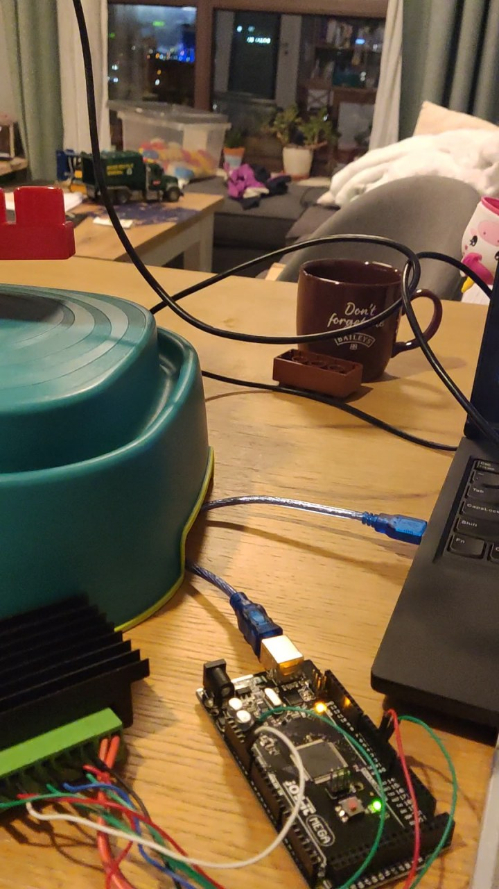
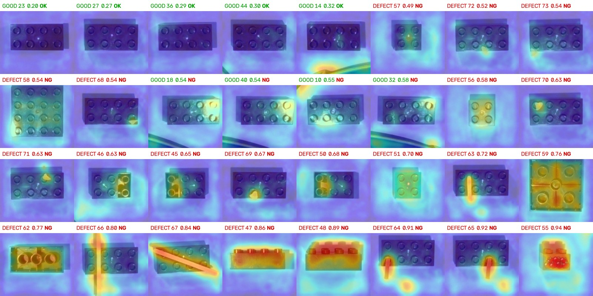
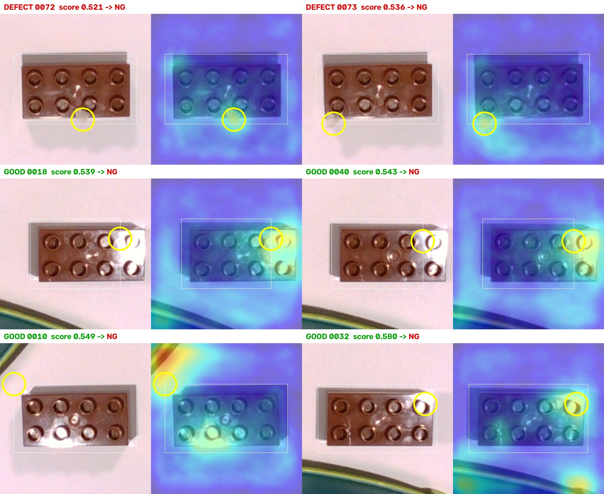

# Инспекционна клетка с машинно зрение и AI: демо

Малка, но завършена роботизирана клетка, изградена за няколко дни у дома. 3D камера разпознава
детайл (тухличка LEGO Duplo), AI модел решава дали е годен, а стъпков двигател с рамо удря
негодните детайли. Целта е да покажа целия път, който обявата описва: камера → AI → решение →
изпълнителен механизъм, с калибриране, самодиагностика и честно отчетени резултати.

## Какво показва демото спрямо обявата

| Изискване в обявата | Къде се вижда в демото |
|---|---|
| AI за инспекция, измерване и разпознаване | PatchCore (откриване на аномалии), обучен **само на 27 снимки на годни детайли**; топлинна карта показва къде е дефектът; измерване на размера на детайла |
| Връзка камера ↔ робот/PLC в реално време | Компютърът решава OK/NG и командва Arduino + драйвер + стъпков двигател; при липса на отговор се показва `MOTOR FAULT` |
| Самодиагностика, обработка на грешки, адаптивни решения | Клетката отказва да инспектира, когато детайлът не е изцяло в зоната, когато има повече от един детайл или ръка в зоната (`NO INSPECTION`) |
| Оптични параметри и координатни системи | Заключени експозиция/усилване/баланс на бялото с проверка за несъответствие; зона за инспекция, настроена на живо; завъртане на детайла към стандартна ориентация преди анализа |

## Кадри от видеото

| | |
|---|---|
|  |  |
| **NG**: върху тухличката има пръчица. Топлинната карта я очертава точно, а правилото за размер също сработва (`WRONG_SIZE, SURFACE_ANOMALY`, оценка 0.907, анализ за 14 ms). | **OK**: годна тухличка, „all checks passed“, оценка 0.316 при праг 0.521, анализ за 20 ms. |
|  |  |
| **NO INSPECTION**: ръка на оператора е в зоната. Клетката не гадае, а отказва да инспектира. | **Клетката**: NEMA 17 с Г-образно рамо от дървени пръчици, което удря негодния детайл. |

*Електроника: Arduino Mega 2560, микростъпков драйвер (тип TB6600) и захранване.*

## Как работи

**Хардуер:** Intel RealSense D435 (цветно изображение + дълбочина) на ~36 см над работната зона;
лаптоп с RTX 3080; Arduino Mega 2560; микростъпков драйвер; NEMA 17 (1/16 стъпка, 3200
стъпки/оборот, ток 1.0 A).

**Обработка на всеки кадър:**
1. **Намиране:** детайлът се търси само в зададената зона (ROI), за да не пречат околните
   предмети. Ако нещо стърчи извън зоната или има повече от един детайл, инспекция не се прави.
2. **Изправяне:** детайлът се завърта така, че дългата му страна да е хоризонтална, и се изрязва
   240×240 px. Моделът винаги вижда детайла в една и съща ориентация.
3. **Правила (геометрия):** дължина и ширина спрямо статистиката на годните детайли. Хваща
   грешна форма (2×2, плочка, легнала тухличка) детерминирано и обяснимо.
4. **AI (повърхност):** PatchCore дава топлинна карта. Оценката е максимумът ѝ **само в
   областта около детайла**, а не в целия кадър.
5. **Решение:** OK само ако всички правила минават и оценката е под прага. NG носи причината.
   Анализът отнема 14–20 ms на кадър на GPU, така че работи в реално време.

**Оптика и калибриране:** автоматичната експозиция и балансът на бялото се „заключват“, за да не
се мени картината между кадрите. Камерата на D435 не докладва какво е избрал автоматичният режим,
затова инструментът мери изображението и търси ръчни настройки, които го възпроизвеждат, и
предупреждава при несъответствие. Зоната за инспекция се настройва на живо с клавиши.

## Резултати, без разкрасяване

Обучение: 27 снимки на годни тухлички, **4.5 s** на GPU. Проверка върху 32 снимки, които моделът
не е виждал (9 годни, 23 дефектни: легнали и обърнати тухлички, грешен цвят и форма, пръчици,
малки парченца хартия):

- **всички 23 дефекта са хванати**: 12 от правилото за размер, останалите от AI модела;
- **4 от 9 годни са отхвърлени погрешно**: за да се хванат най-малките парченца хартия
  (оценка 0.52–0.54), прагът е нисък, а някои годни тухлички с отблясъци са малко над него.

Оставих резултата такъв, какъвто е. Перфектен резултат при 32 снимки би изглеждал нагласен, а
причините за грешките са известни и се решават.

**Всички 32 проверочни снимки, подредени по оценка.** Надписът показва истинския клас и оценката
(зелено = годна, червено = дефектна), а след тях решението на клетката (**OK** зелено, **NG**
червено). Грешното решение се вижда веднага: зелено „GOOD“ с червено „NG“.

Дефектите светят точно там, където са: пръчицата, парченцето хартия, рисунката, обърнатата
тухличка. Четирите годни тухлички, отхвърлени погрешно (втори ред), са в средата на скалата,
между най-малките дефекти.

**Граничните случаи отблизо:** снимка | топлинна карта. Бялата рамка е областта, в която се
оценява; жълтият кръг е най-горещата точка, т.е. това, което определя оценката.

- **Дефекти 0072 и 0073:** кръгът е точно върху малкото парченце хартия. Моделът го вижда, но с
  малък запас над прага.
- **Годни 0018 и 0040:** отблясъкът на лампата по пъпките вдясно е толкова силен, че намирането
  на детайла **отрязва този край**: рамката е изместена наляво и минава през тухличката. Отблясъкът
  вреди два пъти: и на намирането, и на оценката.
- **Годна 0032:** най-горещата точка е отблясък върху пъпка.
- **Годна 0010:** най-горещата точка е ръбът на кутията, който влиза в ъгъла на изрязаното.

### Предишна итерация: как една грешка промени метода

В първата версия, за да не се виждат кутиите, всичко извън зоната за инспекция се „боядисваше“
в цвета на хартията. Топлинните карти показаха, че това създава нов проблем:

*Първа версия: снимка | топлинна карта, жълт кръг = най-горещата точка. При дефектите (парченца
хартия) кръгът е върху дефекта. При двете погрешно отхвърлени годни тухлички (0032, 0010) кръгът
е в празния ъгъл, върху **шева**, където боядисаната площ среща истинската хартия. Моделът
никога не е виждал такъв шев и го приема за аномалия.*

Изводът: грешката беше в обработката, не в детайла или модела. Затова в сегашната версия нищо не
се боядисва. Зоната само определя **къде да се търси** детайлът, а оценката се смята само в
областта около него. Така измерване, а не догадка, промени архитектурата.

## Какво не е перфектно и как се решава

| Проблем | Решение |
|---|---|
| Отблясъци от лампата по пъпките на тухличката (0018, 0040, 0032) | Дифузер на светлината или кръстосана поляризация (стандартът за гланцова пластмаса); повече годни примери с отблясъци в обучението; намиране на детайла по дълбочина, за да не се „отрязва“ осветеният край |
| Околни предмети в ъгъла на изрязаното (0010) | Оценка само в областта на детайла (вече е така) плюс по-плътна зона за инспекция; в реална клетка: фиксиран фон |
| Сенки (напр. от рамото) | Намиране на детайла по **дълбочина**: сянката няма височина. Покритието с дълбочина в зоната е 94–99 % |
| Сиви и бели детайли върху бяла хартия | Пак дълбочина вместо цвят |
| Оценки близо до прага | Три зони вместо един праг: **OK / NG / RECHECK**. Граничен детайл се заснема отново и при съмнение спира за оператора; никога не се пропуска или изхвърля „тихо“ |
| Праг, избран върху същите снимки | Прагът се избира върху валидационен набор, а крайните числа се отчитат веднъж, върху отделна сесия |

По пътя имаше и „полеви“ проблеми, които всяка клетка среща: USB 2 кабел, който ограничава
камерата, лампа, която пробива дупки в картата на дълбочина, DIP превключватели, четени
наобратно (3.0 A вместо 1.0 A), разхлабени проводници, предмети, преместени след калибриране.
Всеки е открит с измерване, не с налучкване, и е записан в документацията.

## Следващи стъпки (проектирани, предстои реализация)

- **Modbus RTU** между компютъра (master) и Arduino (slave) с 4-стъпков handshake
  (READY → REQ → BUSY → DONE), heartbeat в двете посоки и timeout-и, същата карта на регистрите,
  която би се конфигурирала към реален PLC;
- **автоматичен цикъл:** детайлът се успокоява → инспекция → удар → **проверка с камерата, че
  детайлът наистина е помръднат** (`REJECT_FAILED`, ако не е);
- откриване на детайла по дълбочина; дифузна светлина;
- C++ версия на анализа: модел, експортиран към ONNX, за вградена система.

## Технологии

Python, OpenCV, Intel RealSense SDK (pyrealsense2), PyTorch + anomalib (PatchCore,
WideResNet-50), Arduino (C++), AccelStepper, pyserial; Modbus RTU (pymodbus / ModbusRTUSlave)
за следващата стъпка.
