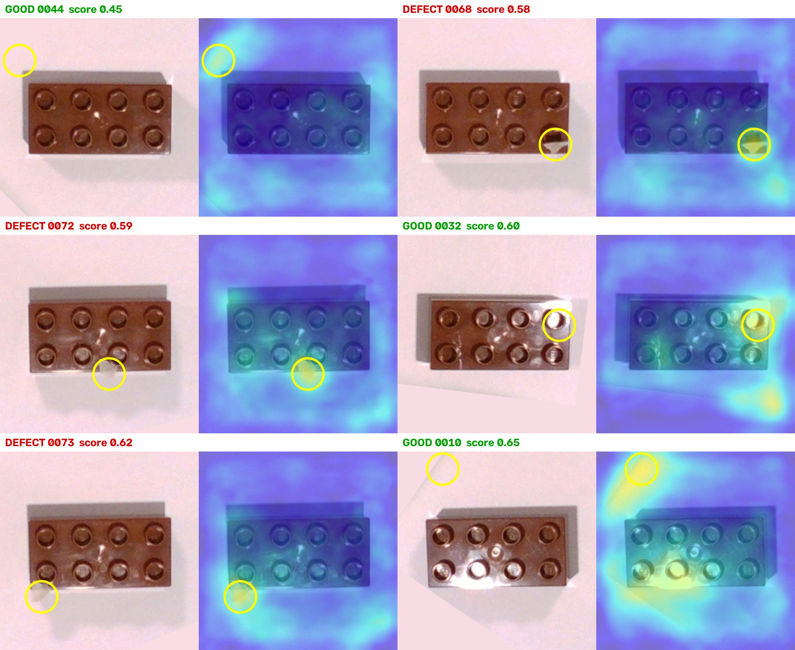

# Anomaly detection spike — results and how the failures are handled

**Date:** 2026-10-11 · **Data:** `data/session1` · **Code:** `spike/` (throwaway, reproducible with seed 42)

These are the unedited results of the first end-to-end test. They are not perfect, and the
imperfections are kept on purpose: each one has a known cause and a known handling, which is what
a production cell needs anyway.

## Setup

- RealSense D435, ~36 cm above white paper, one lamp, exposure and white balance locked.
- Plate box (`config/plate_roi.json`) fitted by hand to keep the toy tubs at the sides out of view.
- Pipeline: locate the part inside the plate box → rotate to horizontal → 240×240 crop → PatchCore
  (wide_resnet50_2, layers 2+3) trained on **27 good bricks only**, no defect ever shown to it.
- Held out for testing: 9 good bricks + 23 defects.
- Training 4.2 s, inference 32 images in 1.1 s (RTX 3080 Laptop).

## Results

| Defect type | Count | Scores | Caught |
|---|---|---|---|
| On its side / upside down | 3 | 0.93–1.00 | all |
| Stick across or on the brick | 5 | 0.89–1.00 | all |
| Printed / other color / other shape | 9 | 0.50–1.00 | all (0057 exactly at 0.50) |
| Small paper scrap on the brick | 6 | 0.58–0.78 | all, weakest margin |

Good bricks scored 0.22–0.45, except two:

| Good brick | Score | Where the heat is |
|---|---|---|
| 0032 | 0.60 | seam in the crop corner + glare on a stud |
| 0010 | 0.65 | seam in the crop corner + glare on a stud |

At the threshold that catches every defect (0.50), **2 of 9 good bricks are falsely rejected**.
The threshold was picked on the same images, so even this is optimistic; the real number comes
from a separate test session.

Six parts were never located and so never scored: three grey and two white parts (no color
contrast on white paper) and one brick lying partly outside the plate box.

*Each pair: photo | heatmap. Yellow circle = hottest spot, which sets the score. On the paper-scrap
defects it lands exactly on the scrap; on the two false rejects it lands on the corner seam.*

All 32 heatmaps: [spike_heatmaps_all.jpg](../images/spike_heatmaps_all.jpg)

## Causes

1. **Seam from the outside-box fill (our bug).** To hide the tubs, everything outside the plate box
   is painted paper-colored before cropping. The fill does not match the real paper's shading, and
   when a brick sits near the box edge its crop contains the straight seam. The model has never seen
   a seam on good bricks, so it is "anomalous". This is an artifact of the pipeline, not of the part.
2. **Specular glare.** The single lamp makes bright reflections on the glossy studs. Their position
   depends on where the brick lies, and 27 training images do not cover them all.
3. **Low-contrast parts.** Grey and white parts are not separated from white paper by color alone.
4. **Tiny defects have small margins.** A paper scrap a few millimetres wide scores 0.58–0.62, close
   to the worst good bricks.

## Handling

| Problem | Handling in the cell | Type |
|---|---|---|
| Seam artifact | Do not paint. Use the plate box only to decide where to search; score only a part-shaped ROI (measured part rectangle + margin), so crop corners never count. | fix |
| Glare | Diffuse the light (diffuser over the lamp) or cross-polarize (polarizer on light + camera), the standard fix for glossy plastic. Add glare cases to the training set. | fix |
| Low-contrast parts | Locate with depth (height above the table plane) as well as color; depth coverage is 94–99 % in this setup. | fix |
| Wrong shape / size (e.g. 0057, 2×2 at 0.50) | Geometry rules: measured length/width/height in mm against tolerance. Rules decide shape, the model decides surface. | design |
| Scores near the threshold | Three bands instead of one threshold: **OK** below the lower bound, **NG** above the upper bound, **RECHECK** in between: re-image the part, and if still uncertain stop for the operator. A borderline part is never silently passed or scrapped. | design |
| Part partly outside the plate box | Not inspected; HMI shows `PART_OUTSIDE_ZONE`, operator re-seats it. | design |
| Optimistic threshold | Thresholds chosen on a validation split; final numbers reported once, on a separate test session. | process |
| Drift (light, camera moved) | Log every score; the self-diagnostics watch brightness, sharpness, depth coverage and plane position, and stop the cell instead of producing false rejects. | process |
